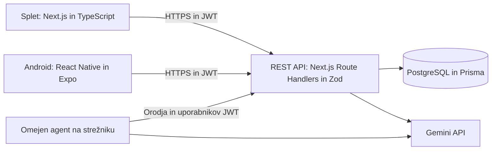

# FieldOps – upravljanje vzdrževanja opreme s podporo UI

FieldOps je načrtovan majhen informacijski sistem za delavnice in laboratorije: tehnik prijavi okvaro naprave, skrbnik dodeli izvajalce, ekipa pa spremlja obravnavo in zgodovino sprememb.

Projekt pri predmetu **Informacijski sistemi, UL FRI, 2026/27**. Repozitorij: <https://github.com/is-fri-2026/fieldops-is>.

## Avtorja in dejansko stanje

| GitHub račun | Predlagana odgovornost |
|---|---|
| [@luka1222424](https://github.com/luka1222424) | API, podatkovni model, avtorizacija, transakcije, testi zaledja, CI/CD |
| [@amarkrasniqi54321-ctrl](https://github.com/amarkrasniqi54321-ctrl) | Spletni poteki, Android, uporabniški pregled predlogov LLM in agenta, testi odjemalcev |

Prava imena niso bila potrjena; navedena sta preverjena računa. Delitev je predlog za skupno potrditev. Dokumentacijo je pripravil Codex po navodilih nosilca računa @luka1222424. Prispevek drugega člana in medsebojni pregled še nista izkazana; noben pregled ni predstavljen kot že opravljen.

**Mejnik tega PR je predlog, ne delujoča aplikacija.** Pripravljeni so zgodbe, ER-model, arhitektura, pogodba OpenAPI in preverjanje dokumentacije. `src/` in `mobile/` ostajata izvorni prazni mapi predloge. Prijava, strežnik, podatkovna baza, mobilna aplikacija, agent in namestitev še niso implementirani.

## Javno okolje in lokalni zagon

| Del | Preverjeno stanje |
|---|---|
| Splet | Še ni nameščen; URL bo dodan pri `final` |
| API in `/api/docs` | Še ni nameščen; pogodba je [OpenAPI](docs/api/openapi.yaml) |
| `/health` | Načrtovan; trenutno strežnik ne obstaja |
| Android | Še ni implementiran; APK in navodila bodo v Releases pri `final` |

Trenutno je mogoče zagnati samo preverjanje predloga (Node.js ≥22.12, npm ≥10.9.2):

```bash
npm ci
npm run validate
```

To preveri OpenAPI, Mermaid, lokalne povezave in strukturo predloga. Ukazi za zagon in testi aplikacije bodo dodani ob implementaciji, ne opisani kot že delujoči. Trenutni [CI](.github/workflows/ci.yml) preverja dokumentacijo na vsak PR in push v `main`.

## Načrtovana arhitektura



Splet in API bosta en Next.js proces v vsebniku na Railway; podatki v upravljanem PostgreSQL. Celotna utemeljitev in dve alternativi sta v [ADR 0001](docs/decisions/0001-stack.md). Dve vlogi, pet entitet in en sam tok prijave okvare omejijo obseg na dve osebi.

Predvidene glavne različice: Node.js 22 LTS, Next.js 16, React 19, TypeScript 5, PostgreSQL 17, Prisma 6, Zod 4; Expo SDK 54 in njegov združljivi React Native. To so **cilji implementacije**, ne nameščene aplikacijske odvisnosti. Točne združljive različice bodo ob uvedbi zaklenjene v lockfile.

## Načrtovana konfiguracija in testi

Strežniške spremenljivke: `DATABASE_URL`, `JWT_SIGNING_KEY`, `AGENT_CONFIRMATION_KEY`, `GEMINI_API_KEY`, `LLM_MODEL`, `APP_ORIGIN`, `API_BASE_URL`. Model se izbere med takrat podprtimi Gemini modeli s strukturiranim izhodom in function calling. Ključi ne sodijo v Git, mobilni paket ali `NEXT_PUBLIC_*`. Android potrebuje samo javni `EXPO_PUBLIC_API_BASE_URL`; JWT se shrani v SecureStore, spletni JWT samo v pomnilniku.

Pri `midterm` bodo dodani seed z obema vlogama in opremo, migracije, lokalna konfiguracija baze, Dockerfile, ukazi za aplikacijo, enotski testi in najmanj trije integracijski testi API. Pri `final` sledijo javni HTTPS URL-ji, avtomatizirana dostava, Android in navodila za fizični telefon ter emulator. Android bo podpiral seznam, ustvarjanje in urejanje prijav prek istega nameščenega API.

Cloud gostovanje in morebitna poraba LLM lahko povzročita stroške; ta PR ne ustvarja računov, ne kupuje storitev in ne kliče modela. Testi bodo uporabljali mock ponudnika LLM.

## Dokumentacija in oddaja

| Dokument | Vsebina |
|---|---|
| [Predlog](docs/proposal.md) | Problem, vloge, 7 Must in 4 Should zgodbe, issueji, pogoji, načrt in tveganja |
| [Podatkovni model](docs/data-model.md) | Natanko pet entitet, ER, ključi, M:N, pravila |
| [Arhitektura](docs/architecture.md) | Odjemalci, API, varnost, CI/CD in oblak |
| [ADR 0001](docs/decisions/0001-stack.md) | Izbira sklada in resne alternative |
| [Pogodba API](docs/api/openapi.yaml) | Načrtovani REST API, DTO in Problem Details |
| [Agent](docs/agent.md) | Orodja, potrditev, omejitve in evalvacija |
| [Dnevnik UI](docs/ai-usage-log.md) | Dejanska uporaba Codexa in omejitve pregleda |
| [Preverjanje predloga](docs/proposal-verification.md) | Matrika rubrike in še potrebni človeški koraki |

V Moodle oba člana oddasta **isti URL repozitorija**, ne ZIP: `https://github.com/is-fri-2026/fieldops-is`. Oddaja v GitHub ni dokaz oddaje v Moodle ali odobritve asistenta. PR ostane nezdružen do dejanskega pregleda.
