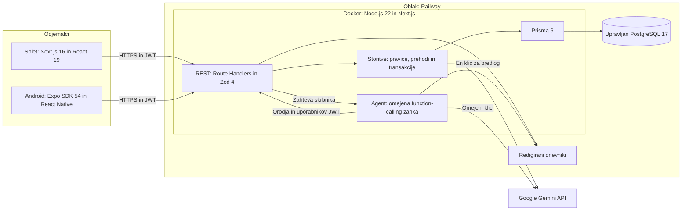
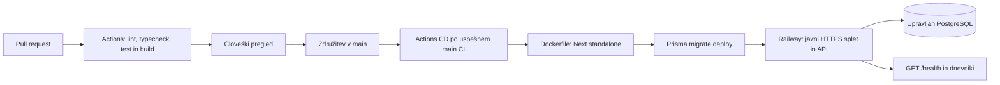

# Arhitektura FieldOps

**Predlog, ne implementacija.** En spletni/API proces in ena baza; Android in agent uporabljata isto pogodbo in pravila. Alternative: [ADR 0001](decisions/0001-stack.md).

## Plasti

| Plast | Načrtovana lokacija in odgovornost |
|---|---|
| HTTP | `src/app/api/`: JWT middleware, Zod DTO, statusi in Problem Details |
| Storitve | `src/server/services/`: pravice, vidnost, statusi, version in transakcije z dogodki |
| Podatki | `src/server/repositories/` in Prisma: poizvedbe, indeksi, migracije; izvoz javnih DTO |
| UI | `src/app/`: prijava, oprema, prijave, zgodovina, dodeljevanje; brez baze v brskalniku |
| Mobilno | `mobile/`: prijava, seznam/podrobnosti, QR, obrazec in urejanje prek API |
| LLM/agent | `src/server/ai/`: adapter, sheme, allowlist orodij, omejitve in token potrditve |

To je prihodnja razporeditev. REST je design-first; [OpenAPI](api/openapi.yaml) določa DTO. Oprema in prijave imata celoten CRUD; dogodki samo branje. Seznami so ostranjeni, `total` se izračuna po filtriranju pravic.

## Avtentikacija in avtorizacija

- Seed računi, brez registracije/ponastavitve gesel. Argon2id za gesla. Prijava vrne podpisan JWT (sub, iat, exp, iss, aud), 30 minut; strežnik določi algoritem/ključ. Brez refresh žetona; ob poteku ponovna prijava.
- Splet shrani JWT samo v pomnilnik, Android v Expo SecureStore. Odjava ga odstrani; izdan JWT ostane veljaven do poteka. Vsaka zahteva preveri aktualni User.active in role v bazi, zato deaktivacija učinkuje takoj.
- Strežnik ne zaupa vlogi, reporterId, statusu ali actorId iz objekta. JWT preveri kriptografsko in po issuer/audience/exp; vhodni DTO imajo `additionalProperties: false`. Tuja podrobnost vrne 404; prepovedana operacija 403; brez prijave 401.
- Admin upravlja opremo/dodelitve, bere vse in ureja odprte prijave. Technician prijavlja, bere lastne/dodeljene in ureja lastne odprte. Status spremeni samo dodeljeni tehnik; [matrika](proposal.md).
- JWT v Authorization headerju, ne v URL. Splet/API isti origin; razvojni origin na točni allowlisti, brez `*` s poverilnicami. Android ima isto avtentikacijo; CORS ni meja avtorizacije. Ni samodejno priloženih auth cookies.
- HTTPS, omejitve prijav/LLM, JSON do 16 KiB, generične napake brez stack trace ali SQL. Transakcije in version varujejo sočasnost; parametrizirane poizvedbe prek Prisma.

## Funkciji UI

**Enkratni predlog:** POST `/api/ai/ticket-suggestions` pošlje samo opis ponudniku Gemini in preveri title/priority/category z Zod. Brez orodij ali zapisa Ticket; uporabnik predlog popravi/zavrže in ločeno odda prijavo. En klic, timeout 15 s, brez samodejne ponovitve, 5 zahtev/min/uporabnika. Napaka → 503 in ročni vnos.

**Agent:** POST `/api/agent/assignment-recommendations` s skrbnikovim JWT zažene zanko. Model prek REST prebere Ticket in tehnike z obremenitvami; obe branji sta obvezni. Strežnik preveri kandidatov ID in izda podpisan 5-minutni token z actor/ticket/technician/version/nonce. UI pokaže točen par in gumb za potrditev. Šele ločeni POST `/api/agent/assignment-confirmations` po človeškem kliku omogoči pisalno orodje, ki pokliče isti REST za dodelitev z JWT in tokenom. Dokazov potrditve ne ustvarja LLM; [podrobnosti](agent.md).

Model nima admin ključa, SQL ali poljubnih URL-jev. Obremenitev je število dodeljenih neumaknjenih OPEN/IN_PROGRESS prijav; brez urnikov, koledarja, vektorske baze ali večagentnega ogrodja.

## Kakovost in CI

Ta PR izvaja deterministično preverjanje dokumentacije: Redocly, Mermaid parser, lokalne povezave, strukturo in zgodbe. CI na pull_request in push v main uporablja lockfile in `npm ci`. To ni build še neobstoječe aplikacije.

Do `midterm`: typecheck, lint, Next build, poslovni enotski testi in najmanj tri API integracije na ločenem PostgreSQL v CI: (1) login + 401/403, (2) Asset CRUD + 409 enoličnost/izbris, (3) Ticket → Assignment → oba statusa → dogodki, tudi 403/409. Dodatno dostop, rollback ob napaki dogodka in sočasna version. Seed za test ne teče samodejno v produkciji.

Do `final`: Android prek nameščenega API, mock LLM (veljaven/neveljaven JSON/timeout), agentova orodna zanka, replay tokena, prompt injection in javni smoke testi. Živi LLM preizkus bo ročen z anonimiziranim opisom; ni predpogoj CI.

## Načrtovana dostava

CD se sproži iz uspešnega CI za main (workflow_run z dodatno preverbo veje/rezultata); avtomatski deploy mimo tega je izklopljen. Večstopenjski Dockerfile loči build in runtime. `prisma migrate deploy` v predeploy fazi; neuspeh prepreči promocijo. Migracije so dodajalne, brez samodejnega destruktivnega rollback; zadnja delujoča aplikacija ostane aktivna. Ponovni zagon ne briše baze. Lasten ADR za migracije/obnovo do final.

`GET /health` kratko preveri bazo in vrne 200/503 brez internosti. Dnevniki imajo correlationId, operacijo, status in trajanje; brez gesel, JWT, ključev ali celotnih opisov. Agent beleži dovoljena imena orodij in izide, ne promptov. TicketEvent je domenska zgodovina, log ni njena zamenjava.

Skrivnosti (`DATABASE_URL`, podpisna ključa, `GEMINI_API_KEY`, deployment token) so v Railway/GitHub secrets. Mobilni API URL je javna konfiguracija. Kvoto/stroške preverimo pred namestitvijo; brez obljub brezplačnosti. Javne URL-je objavimo po dejanski namestitvi.
