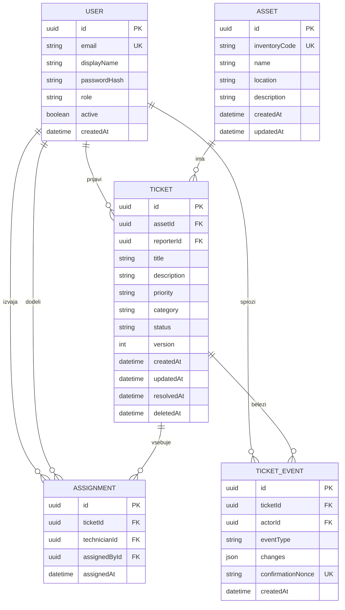

# Podatkovni model FieldOps

**Status: načrt; migracije in baza še niso izvedene.** Natanko pet glavnih entitet. Časi so PostgreSQL `timestamptz` v UTC, identifikatorji UUID. Enum ni samostojna entiteta.

## Entitete in omejitve

| Entiteta | Omejitve in pomen |
|---|---|
| `User` | `email` obvezen, normaliziran v male črke, enoličen; `displayName` 1–100 znakov; `passwordHash` samo strežnik; `role ∈ {admin, technician}`; `active` privzeto true. Računi so pripravljeni s seed; brez registracije ali upravljanja uporabnikov. |
| `Asset` | `inventoryCode` 1–40 znakov, trim + uppercase in UNIQUE; `name` 1–100, `location` 1–100, `description` 0–1000. `id` je vsebina QR-kode; dodatna entiteta QR ni potrebna. |
| `Ticket` | Obvezna `assetId → Asset.id`, `reporterId → User.id`; `title` 3–120, `description` 10–2000 znakov. `priority ∈ {LOW, MEDIUM, HIGH}`, privzeto MEDIUM; `category ∈ {MECHANICAL, ELECTRICAL, SOFTWARE, OTHER}`, privzeto OTHER; `status ∈ {OPEN, IN_PROGRESS, RESOLVED}`, privzeto OPEN. `version >= 1`, začetno 1, ob vsaki spremembi ali dodelitvi +1. `resolvedAt` in `deletedAt` sta nullable. |
| `Assignment` | Obvezni `ticketId → Ticket.id`, `technicianId → User.id`, `assignedById → User.id`. UNIQUE(`ticketId`, `technicianId`); čas in avtor pripadata povezavi. Dodelitev v MVP ne odstranjujemo/prerazporejamo. |
| `TicketEvent` | `ticketId → Ticket.id`, `actorId → User.id`; `eventType ∈ {CREATED, UPDATED, ASSIGNED, STATUS_CHANGED, DELETED}`. `changes` je JSONB z dovoljenimi starimi/novimi domenskimi vrednostmi. `confirmationNonce` je nullable, UNIQUE za nenull vrednosti; samo za agentovo potrjeno ASSIGNED dejanje, brez šeste tabele. Dogodkov ni dovoljeno spreminjati ali brisati prek API. |

Čase nastavi strežnik. Neveljaven vhod vrne 422; enoličnost in konflikt pravil 409. FK uporabljajo `RESTRICT`; ni kaskadnega izbrisa zgodovine. CHECK zagotavlja `resolvedAt IS NOT NULL` natanko pri RESOLVED. Aktivnost/vlogo drugega uporabnika in prehode preveri storitev v transakciji, ne navaden SQL CHECK.

Indeksi: `Ticket(assetId, createdAt)`, `Ticket(reporterId, createdAt)`, `Ticket(status, createdAt, id)`, `Assignment(technicianId, ticketId)` in `TicketEvent(ticketId, createdAt, id)`. Omejitve/indeksi bodo v Prisma migracijah; PostgreSQL-specifičen CHECK po potrebi z SQL migracijo.

## Povezave

- **1:N**: User → Ticket prek reporterId; Asset → Ticket; Ticket → TicketEvent; User → TicketEvent.
- **M:N**: tehnik User ↔ Ticket prek Assignment. Vsaka stran ima več povezav; Assignment vsebuje assignedAt in assignedById.
- Druga povezava User → Assignment predstavlja skrbnika, ki je dodelitev ustvaril; izvajalec in avtor sta ločena.

## Poslovna pravila

1. Vsaka zaščitena operacija preveri JWT, nato aktualno aktivnost in vlogo v bazi. Tehnik bere Ticket in dogodke, če je reporter ali ima Assignment; skrbnik bere vse. Nedostopne podrobnosti se skrijejo z 404.
2. Samo admin ustvarja/ureja/briše Asset. Brisanje je dovoljeno brez katerekoli prijave, tudi umaknjene. Tako je CRUD mogoč brez izgube zgodovine.
3. Ticket ustvarja tehnik; reporterId določi JWT. Metapodatke v OPEN urejata avtor ali skrbnik; assetId in reporterId sta nespremenljiva. Skrbnik lahko DELETE samo OPEN brez dodelitev: nastavi deletedAt in zabeleži DELETED. To je logični umik, ne fizični izbris.
4. Admin dodeli samo aktivnega technician na neumaknjeno OPEN ali IN_PROGRESS prijavo. RESOLVED ne sprejme dodelitve; ni ponovnega odpiranja.
5. Status spremeni samo dodeljeni tehnik: **OPEN → IN_PROGRESS → RESOLVED**. Admin tega ne obide; račun ima eno vlogo. Preskok, isti status in povratni prehod vrnejo 409.
6. Sprememba in njen dogodek sta ena transakcija. Pri urejanju, brisanju, dodelitvi in statusu `UPDATE ... WHERE id = ? AND version = ? AND deletedAt IS NULL` vpliva na eno vrstico, sicer rollback in 409. Dodelitev poveča isto version, zato sočasni zaključek ne obide pravil. Ob napaki dogodka ni spremembe.
7. Umaknjen Ticket ni v običajnem seznamu/GET. Samo admin še bere `/api/tickets/{ticketId}/events`. Ni obnove. Dogodki ne vsebujejo gesel, JWT ali promptov.
8. Agentov token je vezan na actor, Ticket, technician, version, nonce in potek. Prva dodelitev zapiše nonce v ASSIGNED dogodek v isti transakciji. Ponovitev iste veljavne potrditve vrne prvotno dodelitev brez novega dogodka; drugačna vsebina ali potek se zavrne. UNIQUE varuje sočasno ponovitev. Ročna dodelitev nima nonce in za podvojen par vrne 409.

## Podpora zgodbam in seed

| Zgodba | Podpora modela |
|---|---|
| M1 | User, passwordHash, role, active |
| M2 | Asset in enolična inventoryCode |
| M3–M4 | Ticket, Asset, reporterId, version, deletedAt in Assignment za vidnost |
| M5–M6 | Assignment, Ticket.status/version in dogodki transakcije |
| M7 | TicketEvent, actorId, changes in stabilni časi |
| S1–S3 | QR iz Asset.id; LLM enum brez nove tabele; obremenitev iz dodelitev; nonce v TicketEvent |

Idempotenten seed bo pripravil en admin, dva technician računa, tri naprave ter prijave vseh treh statusov z dodelitvami in dogodki. Izmišljeni podatki, e-pošte v `.test` in gesla iz lokalnega okolja. Seed/migracije se preverijo na prazni testni bazi pri `midterm`.
